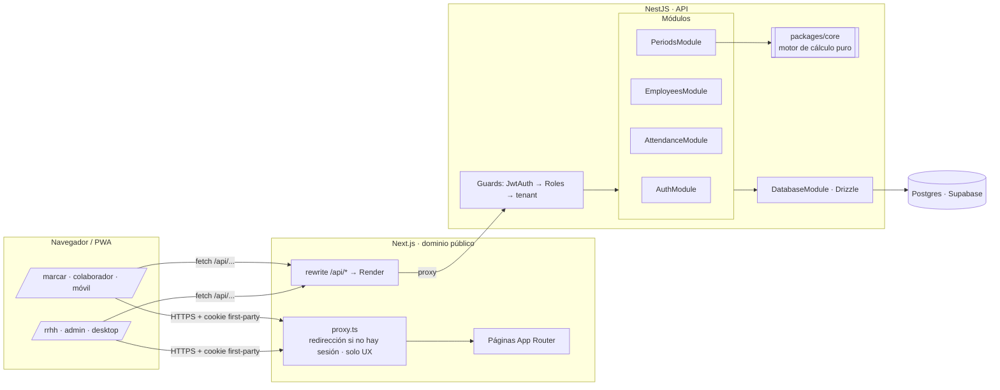

# Plan del sistema · Marcaje

Basado en [`prueba-tecnica-kru-marcaje.md`](../prueba-tecnica-kru-marcaje.md). La UI sigue el [design system](design-system.md) extraído de la landing de Kru.

---

## 1. Stack

| Capa | Elección | Por qué | Descartado |
| --- | --- | --- | --- |
| Lenguaje | **TypeScript** en todo el monorepo | Tipos y motor de cálculo compartidos entre API y web | — |
| Monorepo | **pnpm workspaces** | Sin herramientas extra para 4 paquetes | Nx, Turborepo (sobran a esta escala) |
| Backend | **NestJS 11** (adaptador Express, CommonJS) | Módulos por dominio, guards declarativos para rol y empresa, inyección de dependencias que facilita las pruebas. Es una estructura que cualquier equipo reconoce y que se extiende bien en la sesión en vivo | Fastify suelto (menos estructura), Next API routes (mezcla capas) |
| Motor de cálculo | **`packages/core`**: funciones puras sin Nest ni I/O | El cálculo es lo más evaluado. Se prueba sin levantar Nest ni la base de datos, y Nest solo lo envuelve en un servicio | Lógica dentro del service de Nest (acopla la regla al framework) |
| Validación | **Zod** + un `ZodValidationPipe` propio (~15 líneas) | Los mismos esquemas validan la API y los formularios de la web (`packages/contracts`) | class-validator (duplica las validaciones en el front) |
| ORM | **Drizzle ORM** | SQL explícito, migraciones versionadas y soporte nativo de índices parciales (un turno abierto por persona) y `CHECK`. Se expone en Nest como un provider `DB` | Prisma (los índices parciales requieren SQL a mano), TypeORM (tipado débil) |
| Base de datos | **Supabase, usado solo como Postgres gestionado** | Tiene un panel con editor de tablas, cómodo para el desarrollo y la demo, y deja Storage y Realtime disponibles para los siguientes pasos. No usamos su Auth ni su API REST: la única puerta a los datos es NestJS | Neon (sin pausa por inactividad, pero sin panel ni extras) |
| Auth | **`@nestjs/jwt`** + **argon2**, JWT en cookie `httpOnly; Secure; SameSite=Lax` | Los colaboradores **no tienen email**: entran con cédula + PIN y, si trabajan en varias empresas, eligen dónde marcar. Un proveedor gestionado no modela eso | Supabase Auth, Clerk, Passport (capa extra innecesaria para JWT simple) |
| Seguridad HTTP | `helmet`, `@nestjs/throttler` en login y marcaje | Protege contra fuerza bruta del PIN (4–6 dígitos) | — |
| Fechas | **`@date-fns/tz`** (`TZDate` en `America/Caracas`) | Cortes de 05:00 y 19:00 en hora local sin aritmética manual de offsets | Luxon (más pesado), offset fijo −4 a mano (frágil si cambia la ley) |
| Frontend | **Next.js 16 (App Router) + React 19 + Tailwind v4**, PWA con `app/manifest.ts` | Una sola app: `/marcar` móvil y `/rrhh` desktop, con el design system de Kru. Rutas por archivos, layouts anidados para el shell de RRHH, `next/font` para Inter y rewrites para tener un solo origen. Se despliega en Vercel sin configuración | React + Vite (hay que armar el router, el proxy y la PWA a mano), Expo (exagerado para un botón) |
| Datos en el cliente | **TanStack Query** | Caché e invalidación tras marcar o corregir, sin estado global | Redux, Server Actions (meterían lógica en Next) |
| Tests | **Jest** + **Supertest** (lo que trae Nest 11) | Cero configuración extra en la API. Unit en el core, e2e de API con tests de aislamiento entre empresas | Vitest (requiere SWC para los decoradores de Nest) |
| Deploy | **Web en Vercel** (Next) · **API en Render** (Docker con Nest) · **DB en Supabase** | Cada pieza en la plataforma que mejor la corre gratis. Next reenvía `/api/*` a Render (rewrite), así el navegador ve **un solo dominio**: la cookie es *first-party* y funciona en Safari iOS | Nest sirviendo el front (pierde el CDN y el despliegue de Next), dominios separados con CORS (Safari bloquea la cookie *third-party*) |

> El plan gratuito de Render duerme el servicio tras 15 min sin uso (el primer request tarda ~30–50 s). Se documenta en el README; Fly.io o Railway son alternativas si molesta en la demo.

### Cómo usamos Supabase

- **Conexión:** Nest y Drizzle se conectan con `DATABASE_URL` al **Transaction pooler** de Supavisor (puerto 6543 de `aws-1-us-west-2.pooler.supabase.com`, con `sslmode=require`) y `prepare: false` en postgres.js. En el plan gratuito, la conexión directa es solo IPv6 y Render no la alcanza; el pooler acepta IPv4. El Session pooler (5432) no respondió en las pruebas, y el modo transacción alcanza porque no usamos estado de sesión (`SET`, advisory locks, `LISTEN`). Las migraciones usan la misma URL.
- **Data API (PostgREST) deshabilitada** en *Project Settings → Data API*. Además, RLS queda activo en todas las tablas sin ninguna política, así que aunque alguien obtenga la clave `anon`, no lee nada. El rol de Nest es dueño de las tablas y no lo afecta.
- **No usamos Supabase Auth.** La tabla `users` y el login son propios (cédula + PIN para los colaboradores).
- **Pausa por inactividad:** el plan gratuito pausa el proyecto tras 7 días sin actividad, y reactivarlo es manual. Para evitarlo, un workflow de GitHub Actions llama cada 3 días a `GET /api/health`, que hace `SELECT 1` contra la base. Lo documentamos en el README.
- **Tests y desarrollo local:** Postgres 16 en `docker compose` (`pnpm db:up`). Los tests e2e nunca tocan el proyecto de Supabase.

## 2. Arquitectura



```text
apps/
  api/                         NestJS (Render, Docker)
    src/
      main.ts                  helmet, cookie-parser, prefijo /api, trust proxy
      database/                DatabaseModule: provider DB (drizzle), schema.ts, migraciones, seed
      common/
        auth/                  JwtAuthGuard (global), RolesGuard, @Public(), @Roles(), @CurrentUser()
        zod-validation.pipe.ts
      auth/                    POST register-company, login, logout · GET me
      employees/               CRUD de colaboradores (admin)
      attendance/              punch, today (colaborador y admin), shifts, corrections
      periods/                 cálculo del período + export CSV  → usa @marcaje/core
  web/                         Next.js 16 (Vercel)
    app/
      (public)/login, registro
      marcar/                  colaborador (móvil)
      rrhh/                    layout con sidebar · hoy, colaboradores, periodos
      manifest.ts              PWA instalable
      globals.css              theme de Tailwind v4 (design system Kru)
    components/ui/             Button, Card, Badge, Avatar, Field, Stat, Table…
    lib/api.ts                 cliente fetch a /api + hooks de TanStack Query
    proxy.ts                   (en Next 16 `middleware` se renombró a `proxy`)
    next.config.ts             rewrites /api/:path* → API_URL
packages/
  core/                        calcularTurno, calcularPeriodo, alertasSemanales, aCSV  ← puro + tests
  contracts/                   esquemas Zod + tipos de request/response compartidos (API y formularios)
docs/
```

**Flujo de una request:** el navegador llama a `/api/...` en el dominio de Vercel → Next la reenvía tal cual a Nest (rewrite) → `JwtAuthGuard` lee la cookie y pone `{userId, companyId, role}` en `request.user` → `RolesGuard` verifica `@Roles('admin')` → el controller toma `@CurrentUser()` y pasa **`companyId` explícito** al service → el service consulta siempre filtrando por `company_id`.

**Reparto de responsabilidades entre Next y Nest:**
- **Next no tiene lógica de negocio ni acceso a la base de datos.** No hay Route Handlers ni Server Actions que toquen datos: todo pasa por Nest. Así la autorización y el cálculo viven en un solo lugar, como pide el enunciado.
- `proxy.ts` solo comprueba si existe la cookie para redirigir a `/login`. Es comodidad de UX, **no** autorización; quien decide es Nest.
- Las pantallas son Client Components con TanStack Query: son interactivas (marcar, corregir, filtrar períodos) y detrás de login no aportan SEO ni SSR.
- **El rewrite mantiene un solo origen.** El navegador solo ve el dominio de Vercel, la cookie es *first-party* (funciona en Safari iOS) y no hace falta CORS.
- **IP real del cliente:** Nest corre detrás de dos proxies (Vercel y Render), así que activamos `trust proxy` y el throttler limita el login por **cédula** (o correo), además de por IP.

## 2.1 Roles

Cuatro roles: `superadmin`, `admin`, `analyst` y `employee`. Las empresas tienen dos niveles: un grupo (la empresa padre) y sus sub-empresas. Admins y analistas se asignan a varias empresas de un mismo grupo; cada colaborador pertenece a una sola empresa. Los permisos, los casos de uso y las vistas de cada rol están en [`requisitos.md` §2–3](requisitos.md#2-roles).

## 3. Modelo de datos

El esquema completo, con la fase A ya migrada y la fase B de nómina diseñada, está en [`requisitos.md` §5](requisitos.md#5-modelo-de-datos). Las tablas de la fase A son `company_groups`, `companies`, `users`, `user_companies`, `employees`, `shifts` y `shift_corrections`.

Decisiones:
- **Modelamos turnos, no marcas sueltas.** "Marcar" abre o cierra un turno, lo que evita marcas huérfanas o dos entradas seguidas. La base garantiza un solo turno abierto (índice único parcial, incluso con dos taps simultáneos) y que no haya turnos solapados (`EXCLUDE USING gist`).
- **Las correcciones no sobrescriben sin dejar rastro.** El turno queda con el valor corregido y `shift_corrections` guarda el antes, el después, quién lo cambió y el motivo. Así se audita sin complicar el cálculo.
- **Las horas se guardan en UTC** (`timestamptz`) y se convierten a `America/Caracas` solo para clasificarlas y mostrarlas. La hora del marcaje la pone el servidor y **nunca el cliente**.
- **Las FKs compuestas** impiden, desde la propia base, que un turno quede en una empresa distinta a la de su colaborador o que un admin tenga asignada una empresa de otro grupo.

## 4. Autorización (multiempresa)

- `JwtAuthGuard` es global: toda ruta exige sesión salvo las marcadas `@Public()` (registro y login). El JWT solo lleva `{sub, kind}`. El guard carga en cada request `{id, role, groupId, companyIds}` desde la base, así que desactivar a alguien o cambiar sus empresas aplica de inmediato.
- Los repositorios **exigen `companyId`** como parámetro, y ese id debe estar en las `companyIds` de la sesión (el superadmin accede a todas). No existe una consulta sin él. Si alguien pide un recurso de otra empresa, la API responde **404, no 403**, para no revelar que existe.
- `RolesGuard` + `@Roles()`. Rol `employee`: solo `POST /me/punch` y `GET /me/*`. Roles `admin` y `analyst`: `/admin/*` de sus empresas, y algunas rutas solo para `admin` (equipo y KPIs profundos).
- Tests explícitos: el admin de B no ve, no corrige ni exporta datos de A, y el colaborador de A no accede a `/admin`.

## 5. API

```text
POST /auth/register-company     crea grupo + empresa + admin
POST /auth/staff/login          superadmin, admin, analista: email + password
POST /auth/employee/login       colaborador: cédula + PIN (+ companyId si trabaja en varias empresas)
POST /auth/logout   GET /auth/me

POST /me/punch                  abre o cierra el turno (hora del servidor)
GET  /me/today                  estado + turnos de hoy

GET    /admin/employees         POST /admin/employees    PATCH /admin/employees/:id
GET    /admin/today             { dentro[], sinMarcar[], sinSalida[] }
GET    /admin/shifts?from&to&userId
PATCH  /admin/shifts/:id        { clockIn?, clockOut?, reason }   ← reason obligatorio
POST   /admin/shifts            turno manual (olvido total), también con reason
GET    /admin/periods?from&to   cálculo por colaborador + alertas
GET    /admin/periods/export.csv?from&to
```

## 6. Motor de cálculo (`packages/core`)

**Algoritmo por turno:**
1. Se convierten la entrada y la salida a hora de Caracas. La fecha del turno es la fecha local de la entrada.
2. `corte = entrada + 8h`. El tramo `[entrada, corte)` es ordinario y `[corte, salida)` es extra.
3. Cada tramo se parte en las fronteras locales de 05:00 y 19:00. Cada sub-tramo es nocturno si su hora local está en `[19:00, 05:00)` y diurno en caso contrario.
4. Se acumulan **minutos enteros**: `ordinarios`, `nocturnaOrdinaria`, `extraDiurna`, `extraNocturna`.

**Por período:** se suman los minutos de todos los turnos con fecha dentro de `[desde, hasta]` y **solo al final** se calcula `round(min/60, 2)`.

**Alerta:** se agrupan los minutos extra por semana ISO (lunes a domingo, según la fecha del turno). Si superan 600 min (10 h), RRHH ve una alerta en esa semana. Si el período es una quincena, se evalúa cada semana que toca.

**Comprobación con los ejemplos del enunciado:**
- **Lun 06:00→16:00:** el corte es a las 14:00. De 14:00 a 16:00 hay 2,00 h de extra diurna y no hay horas nocturnas. ✔
- **Mar 14:00→Mié 00:30:** el corte es a las 22:00. La nocturna ordinaria va de 19:00 a 22:00 (3,00 h) y la extra nocturna de 22:00 a 00:30 (2,50 h). ✔

**Casos de prueba adicionales:**
- Turno nocturno completo, 22:00→07:00: cruza la frontera de las 05:00 dentro de las horas extra.
- Turno de 8 h exactas: 0 h extra.
- Entrada o salida exactamente a las 19:00 o a las 05:00: límites semiabiertos.
- Un turno que empieza el domingo cuenta en esa semana y en ese período, aunque termine el lunes.
- Redondeo: tres turnos de 20 min de extra suman 1,00 h y no 0,99 h.
- Alerta con 10 h exactas: no salta. Con 10 h y 1 min: sí salta.
- Turnos abiertos: se excluyen del cálculo y se listan como pendientes.

**CSV:** `;` como separador, punto decimal, UTF-8 con BOM (para que Excel lea las tildes), una fila por colaborador **activo**, incluidos los que tienen 0 h.

## 7. Pantallas

Las vistas por rol y por fase están en [`requisitos.md` §3](requisitos.md#3-casos-de-uso-y-vistas). La pantalla del colaborador (`/marcar`) muestra la hora actual en grande, el estado y un botón XL "Marcar entrada" o "Marcar salida", más los turnos de hoy. Las de RRHH (`/rrhh/*`) usan un layout con sidebar y un selector de empresa.

## 8. Supuestos a documentar en el README

1. La ventana nocturna es `[19:00, 05:00)`: incluye las 19:00 y excluye las 05:00.
2. Las quincenas van del 1 al 15 y del 16 a fin de mes. La semana va de lunes a domingo.
3. **Ver el día:** "Dentro" son los turnos abiertos que empezaron hoy. "Sin salida" son los turnos abiertos de días anteriores (olvidos) y los que pasan de un umbral (por ejemplo 16 h). "No ha marcado" son los colaboradores activos sin turno con fecha de hoy.
4. Un turno abierto no se calcula hasta que RRHH lo cierra con una corrección.
5. Los minutos se truncan al minuto en el que ocurre el marcaje (los segundos se ignoran) para evitar diferencias de redondeo.

## 9. Fases de trabajo

| # | Entregable | Criterio de hecho |
| --- | --- | --- |
| 0 | Esqueleto del monorepo, Tailwind con el theme Kru, CI con lint y tests | `pnpm test` pasa en CI |
| 1 | **`packages/core` + tests** (incluye los 2 ejemplos) | Todos los casos de §6 en verde |
| 2 | Esquema y migraciones con Drizzle, seed con empresas A y B | `pnpm db:seed` crea las credenciales de prueba |
| 3 | API de auth y guard de empresa, con tests de aislamiento | El admin de B recibe 404 sobre los datos de A |
| 4 | API de marcar, hoy, colaboradores y correcciones | Tests de integración |
| 5 | API de períodos y CSV | El CSV coincide con el formato del enunciado |
| 6 | Componentes UI del design system | Página `/ui` interna con todos los componentes |
| 7 | Pantallas del colaborador (móvil) y de RRHH | Recorrido completo a mano |
| 8 | API en Render (Docker), web en Vercel, base en Supabase, con seed en producción | URL pública y las 3 credenciales funcionando |
| 9 | README (diagrama, decisiones, fuera de alcance, siguientes pasos), bitácora de IA y nota de negocio | Entregables 1 a 6 completos |

## 10. Fuera de alcance (y por qué)

- **Geolocalización o foto al marcar:** reduce el fraude, pero exige permisos y más UX. Es el primer "siguiente paso".
- **Modo offline:** la PWA se puede instalar, pero marcar requiere red para que la hora la ponga el servidor.
- **Feriados, descansos y jornadas pactadas:** el enunciado simplifica las reglas a propósito.
- **Integración real con el motor de nómina de Kru:** el CSV es el contrato.
- **Recuperación de PIN por SMS:** RRHH lo restablece.

## 11. Siguientes pasos del sistema (para el README)

- Marcaje con geocerca o QR rotativo en la sede.
- Horarios asignados, para detectar retrasos y ausencias, y no solo horas.
- Aprobación del período ("cerrar quincena") que bloquee las correcciones posteriores.
- Webhook o API directa hacia la prenómina de Kru, en lugar del CSV.
- Integración con relojes biométricos existentes (importar sus logs).
